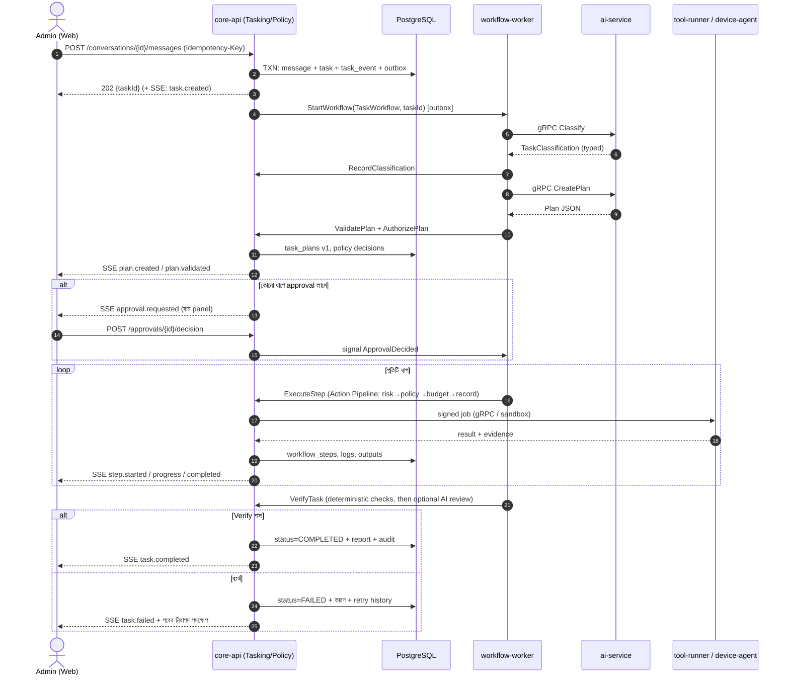

# Dapplesoft Nexus — একত্রিত মাস্টার ডিজাইন (v4)

**AI Agentic Operations Platform** · আগের তিনটি পরিকল্পনা + আপডেটেড Complete Planning (BN) একত্রে · ১১ অক্টোবর ২০২৬

> **দুটি মূল প্রশ্নের সরাসরি উত্তর আছে এই ফাইলের শুরুতেই:** **ক** — কয়টি repository ও কীভাবে ভাগ; **খ** — message এলে কোন service/API/process-এ কাজ শুরু হয় ও কীভাবে শেষ হয়।

---

# ক. সরাসরি উত্তর ১ — কয়টি Repository, কয়টি ভাগ

## ক.১ সংক্ষেপে উত্তর

| পর্যায় | Repository সংখ্যা | কোনগুলো |
|---|---|---|
| **শুরু (Stage A — MVP)** | **১টি** | `dapplesoft-nexus` (monorepo) |
| মাঝামাঝি (Stage B) | ২–৩টি | + `nexus-device-agent`, + `nexus-computer-use` (যদি শর্ত পূরণ হয়) |
| **পূর্ণ সিস্টেম (Stage C)** | **৫টি (সর্বোচ্চ ৬টি)** | নিচের তালিকা |

**পূর্ণ সিস্টেমের চূড়ান্ত ৫টি repository:**

| # | Repository | কী থাকবে | কখন আলাদা হবে |
|---|---|---|---|
| 1 | **`dapplesoft-nexus`** (মূল monorepo) | `admin-web`, `core-api`, `ai-service`, `workflow-workers`, `api-contracts`, `ui-components`, `database/migrations`, `workflows`, `governance/`, `infrastructure/` (CI, docker, monitoring, deploy-agent), `docs` | **প্রথম দিন থেকেই** |
| 2 | `nexus-device-agent` | Go agent (Windows/Linux), OS adapter, updater, signing/release pipeline | agent-এর release UI-র থেকে আলাদা চক্রে চালাতে হলে, বা আলাদা টিম হলে |
| 3 | `nexus-computer-use` | E0 sandbox image, E1 Lab VM template, GUI-control library, Windows GUI helper | Stage B শুরু হলে (ভারী image ও আলাদা security review) |
| 4 | `nexus-learning` | data pipeline code, redaction, dataset builder, LoRA training script, eval harness — **dataset নয়** | Stage C-তে Learning শুরু হলে |
| 5 | `nexus-deployment` | production deploy config, server inventory (secret ছাড়া), runbook | production অ্যাক্সেস শুধু ২–৩ জনের হাতে রাখতে চাইলে |
| (৬) | `nexus-governance` *(ঐচ্ছিক)* | policy YAML, tool definitions, ADR, threat model | policy পরিবর্তনে আলাদা অনুমোদন-দল লাগলে। তার আগে `governance/` folder + CODEOWNERS-ই যথেষ্ট |

আগের ৯-repo পরিকল্পনা (v3) তাই কমে ৫–৬ হয়েছে; `nexus-contracts`, `nexus-ai-orchestrator`, `nexus-core`, `nexus-web`, `nexus-infra` আলাদা repo না হয়ে monorepo-র ভেতরের folder।

## ক.২ কোন অ্যাপ কোন repo-তে (এক নজরে)

| অ্যাপ/অংশ | ভাষা | Repo (শুরুতে) | Repo (পূর্ণ সিস্টেমে) | আলাদা deploy unit? |
|---|---|---|---|---|
| Admin Web (chat UI) | TypeScript (Next.js) | dapplesoft-nexus | একই | হ্যাঁ — container |
| Core API (Identity, Tasking, Policy, Audit, Devices, Tools) | C# | dapplesoft-nexus | একই | হ্যাঁ — container |
| AI Service (Classify/Plan/Review) | Python | dapplesoft-nexus | একই | হ্যাঁ — container |
| Workflow Workers | C# (প্রস্তাবিত) | dapplesoft-nexus | একই | হ্যাঁ — container |
| API Contracts (OpenAPI/Proto/JSON Schema) | — | dapplesoft-nexus | একই (versioned package হিসেবে অন্য repo ব্যবহার করবে) | না |
| Device Agent | Go | dapplesoft-nexus (`agents/`) | **`nexus-device-agent`** | হ্যাঁ — signed binary |
| Sandbox/Lab VM/GUI helper | Python/Go + IaC | — (Stage B) | **`nexus-computer-use`** | image |
| Learning pipeline | Python | — (Stage C) | **`nexus-learning`** | batch job |
| Infra/CI/deploy-agent | YAML/Shell | dapplesoft-nexus (`infrastructure/`) | একই বা `nexus-deployment` | — |
| Governance (policy, ADR) | YAML/MD | dapplesoft-nexus (`governance/`) | একই বা আলাদা | — |

**"কয়টি ভাগ" — আলাদা করে বুঝুন:** *Repository* (কোড কোথায় থাকে) আর *Runtime unit* (কী চলে) এক জিনিস নয়। MVP-তে ১টি repo থেকেই **৬টি runtime unit** চলবে: `admin-web`, `core-api`, `ai-service`, `workflow-worker`, `PostgreSQL`, `MinIO (S3)` — সঙ্গে OpenTelemetry collector আর পরে `device-agent` (প্রতিটি device-এ)। সবগুলো Docker Compose-এ।

## ক.৩ ফাইলের সংখ্যা (মোটামুটি অনুমান — যাচাইকৃত নয়)

| অংশ | MVP-তে আনুমানিক source ফাইল |
|---|---|
| admin-web + ui-components | ১৫০–৩০০ |
| core-api (৬টি মডিউল × চার লেয়ার + test) | ২০০–৪০০ |
| ai-service | ৩০–৮০ |
| workflow-workers | ২০–৬০ |
| device-agent (Go) | ৩০–৮০ |
| contracts, migrations, workflows, infra, docs | ৫০–১৫০ |
| **মোট** | **প্রায় ৫০০–১,০০০** (পূর্ণ সিস্টেমে আরও কয়েকগুণ) |

গুরুত্বপূর্ণ নয় ফাইলের সংখ্যা; গুরুত্বপূর্ণ হলো repo ছোট রাখা (ডেটা/লগ/model weight Git-এ নয়), যাতে GitHub-এর ফাইল-সাইজ ও Actions-মিনিট সীমা ছাড়ায় না।

## ক.৪ ভাগ করার নিয়ম — কখন repo বাড়াবেন

আলাদা repo করুন **শুধু যদি নিচের অন্তত একটি বাস্তব কারণ ঘটে:**

1. **Release cycle আলাদা** (যেমন agent সপ্তাহে ১ বার signed binary, UI দিনে ১০ বার)।
2. **অ্যাক্সেস/ownership আলাদা** (production config বা policy ফাইল শুধু নির্দিষ্ট মানুষ বদলাবে)।
3. **ঝুঁকি/security review আলাদা** (sandbox image, GUI control)।
4. **টুলচেইন/lifecycle সম্পূর্ণ আলাদা** (data-science)।
5. **CI অসহনীয় ধীর** — path filter + cache দেওয়ার পরও।

ভাগ করার পদ্ধতি: `git filter-repo` দিয়ে ইতিহাস-সহ folder বের করা → আলাদা CI → contract নেওয়া **versioned package** (Git tag বা GitHub Packages) থেকে → monorepo-তে পুরোনো folder সরিয়ে লিংক রাখা। Tag-prefix: `web-v1.2.0`, `core-v1.2.0`, `agent-v0.4.0`।

**না করা:** প্রথম দিন ৩–৫টি repo, বা প্রতিটি অ্যাপের জন্য আলাদা repo "নিয়ম রক্ষার জন্য"। এতে contract-sync-এর যন্ত্রণা বাড়ে, সুবিধা কিছু নেই।

---

# খ. সরাসরি উত্তর ২ — একটি message আসলে কাজ কোথা থেকে শুরু হয় এবং কীভাবে শেষ হয়

## খ.১ এক লাইনে উত্তর

> **প্রথম যে process কাজ ধরে সেটি `core-api` (ASP.NET Core)-র `Tasking` মডিউলের Intake endpoint।** AI service সবার আগে নয় — AI আসে তৃতীয় ধাপে, মানুষের পরিচয় ও নিয়ম যাচাইয়ের *পরে*। শেষ হয় `core-api`-র **Report + Completed** ধাপে, তাও কেবল Verify পাস করলে।

**মূল নিয়ম (এগুলো কখনো ভাঙবে না):**

1. **একটিই প্রবেশপথ:** Web chat, Telegram, schedule, webhook — সব `CreateTask` command দিয়ে `core-api`-তে ঢোকে। পাশের কোনো দরজা নেই।
2. **সত্যের মালিক = `core-api` + PostgreSQL।** Task-এর অবস্থা, plan, approval, audit — সব `core-api`-ই লেখে।
3. **`ai-service` স্টেটলেস ও কেবল "চিন্তা করে":** classify, plan, review ফেরত দেয় (typed JSON)। সে **কোনো tool চালায় না, DB-তে লেখে না।**
4. **Workflow worker ক্রম চালায়:** ধাপের ক্রম কোডে স্থির; AI বদলাতে পারে না।
5. **প্রতিটি পার্শ্বপ্রতিক্রিয়া (tool/device/mail) একই Action Pipeline দিয়ে যায়** (ঝুঁকি-শ্রেণি → Policy → approval → execute → record)।
6. **UI শুধু `core-api` ও তার SSE-র সাথে কথা বলে;** ai-service বা device-agent-এর সাথে সরাসরি নয়।

## খ.২ এক নজরে প্রবাহ

```
 Admin (Web chat / Telegram / Schedule / Webhook)
        │  ①
        ▼
 ┌─────────────────────────────────────────────────────────────────┐
 │ core-api  (ASP.NET Core)                                        │
 │  ② Intake: auth → validate → idempotency → DB txn → 202         │
 │  ⑥ Validate (pure) → ⑦ Authorize (policy) → ⑧ Approval gate     │
 │  ⑨ Action Pipeline (risk→policy→budget→record)  ⑪ Report        │
 └───┬──────────────▲──────────────┬───────────────────▲───────────┘
     │ Outbox ③     │ results      │ gRPC (signed job) │ result
     ▼              │              ▼                   │
 ┌──────────────────┴───┐    ┌──────────────────────────┴──┐
 │ workflow-worker      │    │ device-agent (Go) /         │
 │ TaskWorkflow(taskId) │    │ tool runner (Playwright…)   │
 └───┬──────────────────┘    └─────────────────────────────┘
     │ gRPC ④⑤ Classify / Plan / Review
     ▼
 ┌──────────────────────┐
 │ ai-service (Python)  │  stateless · read-only context · no tools
 └──────────────────────┘

 Live: core-api ──SSE──▶ Web (task card, graph, left/right panels)
 সব জায়গায় একই  task-id · run-id · correlation-id  (OpenTelemetry trace)
```

## খ.৩ ধাপে ধাপে — কে, কীভাবে, কী লেখে (NEP S0–S10)

| # | NEP | কে করে | কীভাবে ডাকা হয় (API/protocol) | কী করে | DB/Storage-এ কী লেখা হয় | UI-তে কী দেখা যায় (SSE event) | ব্যর্থ হলে |
|---|---|---|---|---|---|---|---|
| ① | — | **Admin Web** | `POST /api/v1/conversations/{id}/messages` (REST, `Idempotency-Key`, `Correlation-Id`) | message পাঠায়। SSE `GET /api/v1/events` আগে থেকেই খোলা | — | message ভেসে ওঠে (optimistic) | নেটওয়ার্ক ফেল → একই Idempotency-Key-তে retry; ডুপ্লিকেট হয় না |
| ② | **S0 Intake** | **`core-api` / Tasking** (প্রথম process) | এই endpoint-ই | (ক) session + MFA/role যাচাই (খ) schema/size যাচাই (গ) idempotency চেক (ঘ) **একটি DB transaction:** message + task(DRAFT→QUEUED) + `task_events` + **outbox row** → **৪টি লেখা একসাথে বা কোনোটিই নয়** (ঙ) `202 Accepted {messageId, taskId}` ফেরত | `messages`, `tasks`, `task_events`, `outbox` | `task.created` → task card দেখা যায়, status **Queued** | auth/validation ফেল → 4xx + কারণ; কিছুই লেখা হয় না |
| ③ | — | **Outbox dispatcher** (core-api-র ভেতর) | Workflow SDK client call (`StartWorkflow(TaskWorkflow, taskId)`) | outbox থেকে workflow শুরু (at-least-once + idempotent) | `outbox` → processed | status **Running** (S1-এ) | start ফেল → outbox retry (backoff); task আটকে থাকে না |
| ④ | **S1 Classify** | **workflow-worker** → **`ai-service`** | gRPC `Classify(taskId, text, contextRefs)` → typed `TaskClassification` (task-type, data-class, ঝুঁকির প্রাথমিক ধারণা, intent তালিকা) | AI (temperature=0, model pinned) শ্রেণিবিন্যাস করে; worker ফল **`core-api` internal API**-তে রাখে | `task_events`, (বহু intent হলে) child `tasks` | `task.classified`; এক message → একাধিক task হলে একাধিক card | অনিশ্চিত → Admin-কে প্রশ্ন (message হিসেবে); schema-অবৈধ → ≤২ repair → Failed(planning) |
| ⑤ | **S2 Context** | **`ai-service`** (read-only DB role + tool registry) | worker-এর একই gRPC flow-এর ভেতরে | আগের conversation + tool registry + (পরে) skill/knowledge সংগ্রহ; permission-ফিল্টার সহ | — (read-only) | — | খালি হলেও চলবে (exploratory মোড শুধু E0/E1) |
| ⑥ | **S3 Plan** | **`ai-service`** | gRPC `CreatePlan(taskId, classification, context)` → Plan JSON | পরিচিত task-type হলে **template পূরণ**; নইলে AI plan বানায় | `task_plans` (v1) | `plan.created` → card-এ plan ও workflow graph | repair ≤২ → Failed; **অবৈধ plan কখনো চলে না** |
| ⑦ | **S4 Validate** | **`core-api`** (pure function) | worker → internal `ValidatePlan` | schema, dependency-cycle, tool allow-list, বাজেট, acceptance criteria আছে কি | `task_plans.validated=true` | `plan.validated` | অবৈধ → plan reject, কারণ সহ |
| ⑧ | **S5 Authorize** | **`core-api` / PolicyApproval** | internal `AuthorizePlan` | প্রতি ধাপে Policy chain → **ALLOW / DENY / REQUIRE_APPROVAL**; ঝুঁকি-শ্রেণি R0–R3 **server-side**, AI-র ঘোষণা অগ্রাহ্য | `policy_decisions` (বা `task_events`), `audit_events` | `step.authorized` | DENY → ধাপ বাদ বা task Failed |
| ⑨ | **S6 Approve** | **Admin** | `POST /api/v1/approvals/{id}/decision` (উচ্চ ঝুঁকিতে MFA step-up) → core-api workflow-কে **signal** `ApprovalDecided` | approval **plan-version + action-hash**-এ বাঁধা; সিদ্ধান্ত না আসা পর্যন্ত শুধু ওই ধাপ থামে | `approvals` | বাম panel-এ item; status **Waiting for approval**; আলাদা করে **অপেক্ষার সময়** গোনা | Reject → থামে; Timeout → Expired; plan বদলালে পুরোনো approval বাতিল |
| ⑩ | **S7 Execute** | **workflow-worker** → **`core-api` Action Pipeline** → tool/device | প্রতি ধাপে internal `ExecuteStep`; device হলে gRPC bidi stream (outbound-only mTLS, signed job); tool হলে sandboxed tool-runner (Playwright/Git/API) | **১২-ধাপের Action Pipeline** (validate → authn → risk → authorize → budget → approval gate → idempotency → pre-snapshot → execute → sanitize → record → emit) | `workflow_runs`, `workflow_steps` (শুরু/শেষ সময়, retry), `task_logs` (redacted), `task_outputs` (ফাইল → MinIO, DB-তে ref+hash) | `step.started` → `step.progress` → `step.completed`/`step.failed`; graph-এ node-রং/icon বদলায়; **চলমান ধাপ ও সময়** | bounded retry (বার ও timeout নির্দিষ্ট); এখনো ব্যর্থ → Stage B-তে Resolution escalation, MVP-তে Failed + নিরাপদ next action |
| ⑪ | **S8 Verify** | **`core-api`/worker**; (প্রয়োজনে) `ai-service` `ReviewResult` | internal `VerifyTask` | **আগে deterministic check** (acceptance criteria, test, স্কিমা), পরে AI-পর্যালোচনা | `task_events` (verify result) | badge **Verifying** | ব্যর্থ → সীমিত fix-loop (সর্বোচ্চ ২) বা Failed; **AI "শেষ" বললেই Completed নয়** |
| ⑫ | **S9 Report** | **`core-api`** | internal `CompleteTask` | report, evidence, log, খরচ, মোট ও ধাপ-ভিত্তিক সময় চূড়ান্ত | `task_outputs`, `tasks.status=COMPLETED`, `audit_events` | `task.completed` → একই card-এ final report, logs, evidence; conversation-এ সারসংক্ষেপ message | রিপোর্ট ফেল → retry; status বদলের আগে audit লেখা বাধ্যতামূলক |
| ⑬ | **S10 Learn** | `core-api` Learning hook → worker | domain event `TaskCompleted` | Candidate skill/knowledge (**Stage B থেকে**; নিজে Verified করে না) | `skill_candidates` | badge **Learning** | ব্যর্থ হলেও task Completed থাকে |

## খ.৪ Sequence diagram (GitHub/Mermaid-এ রেন্ডার হবে)



## খ.৫ Task status — কোন অবস্থা থেকে কোথায় যেতে পারে

```
DRAFT → QUEUED → RUNNING ⇄ WAITING_APPROVAL
                   │
                   ├─→ COMPLETED   (শুধু S8 Verify পাস করলে)
                   ├─→ FAILED      (কারণ + retry history সহ; "Retry" = নতুন attempt)
                   └─→ CANCELLED   (Admin Stop / Emergency Pause-এর পর)
```

- `RUNNING`-এর ভেতরে উপ-অবস্থা badge: *Classifying, Planning, Executing(step n/N), Verifying, Resolving (Stage B), Learning (Stage B)*, *Paused*।
- অবৈধ transition (যেমন `FAILED → COMPLETED`, `DRAFT → RUNNING` plan validate ছাড়া) **State pattern-এর transition-টেবিলে অসম্ভব**।
- **Retry** পুরোনো `workflow_run` মুছে না; নতুন `attempt` যোগ হয়।

## খ.৬ MVP API ও Event তালিকা

**REST (Web ↔ core-api), সব `/api/v1/…`:**

| Method + Path | কাজ |
|---|---|
| `POST /conversations/{id}/messages` | নির্দেশ জমা (**প্রবেশদ্বার**) |
| `GET /conversations/{id}/messages` | ইতিহাস (পেজিনেশন) |
| `GET /tasks/{id}` , `GET /tasks?status=` | task বিবরণ/তালিকা |
| `GET /tasks/{id}/plan` , `/runs` , `/steps` , `/logs` , `/outputs` | card-এর বিভিন্ন tab |
| `POST /tasks/{id}/cancel` , `/retry` , `/pause` , `/resume` | নিয়ন্ত্রণ |
| `GET /approvals?status=pending` , `POST /approvals/{id}/decision` | বাম panel |
| `GET /agents` , `GET /devices` | Agents menu |
| `GET /events` (SSE) | লাইভ update |
| `POST /system/emergency-pause` | সব চলমান কাজ ফ্রিজ |

**gRPC:** `ai-service`: `Classify`, `CreatePlan`, `ReviewResult` · `core-api (internal)`: `RecordClassification`, `ValidatePlan`, `AuthorizePlan`, `ExecuteStep`, `VerifyTask`, `CompleteTask` · `device-agent`: bidirectional job stream (outbound-only, mTLS)।

**SSE event:** `task.created`, `task.classified`, `plan.created`, `plan.validated`, `approval.requested`, `approval.decided`, `step.started`, `step.progress`, `step.completed`, `step.failed`, `task.verifying`, `task.completed`, `task.failed`, `task.cancelled`, `agent.offline`। প্রতিটিতে `taskId, runId, ts, correlationId`।

## খ.৭ সময় কীভাবে মাপা হয় (UI-তে "কত সময় লাগছে")

| মাপ | কীভাবে |
|---|---|
| মোট সময় | `COMPLETED/FAILED.ts − created.ts` |
| Queue-তে অপেক্ষা | `first RUNNING.ts − created.ts` |
| প্রতি ধাপের সময় | `workflow_steps.finished − started` |
| **Approval-এর অপেক্ষা (মানুষের দেরি)** | আলাদা — যাতে সিস্টেমের গতি ও মানুষের গতি মিশে না যায় |
| Retry-তে হারানো সময় | ব্যর্থ attempt-গুলোর সময়-যোগফল |
| AI vs Tool vs Device সময় | step-এর ধরন অনুযায়ী ভাগ |

সবই `workflow_steps`/`task_events`-এর timestamp থেকে; একই ডেটা Monitor menu-র গড়/p95 চার্ট চালায়।

## খ.৮ ব্যর্থতা ও সীমা — কোথায় কী ঘটে

| পরিস্থিতি | আচরণ |
|---|---|
| `ai-service` নেই/ধীর | gRPC timeout + retry (backoff); না হলে task **Failed(planning)** — কাজ চালু হয় না, আংশিকও না |
| Plan অবৈধ | সর্বোচ্চ ২ repair; তারপর Failed |
| Policy DENY | ওই ধাপ বাদ বা task Failed (কারণ দেখানো) |
| Approval না আসা | নির্দিষ্ট সময় পর Expired; কাজ থেমেই থাকে, এগোয় না |
| Tool/device ধাপ ব্যর্থ | bounded retry; idempotency key দিয়ে ডুপ্লিকেট কাজ রোধ |
| Device offline | ধাপ queued/paused; ডান panel-এ `agent.offline` |
| Worker/server restart | workflow state থেকে চলা পুনরায় শুরু (Temporal PoC-তে test করা হবে); না হলে DB state machine থেকে |
| UI connection হারালো | task চলতেই থাকে; reconnect-এ SSE `Last-Event-ID` দিয়ে মিস হওয়া event পুনরায় |
| Admin Stop | `cancel` → workflow signal → চলমান ধাপে নিরাপদ stop → CANCELLED |
| Emergency Pause | সব চলমান ধাপ ফ্রিজ, নতুন Execute বন্ধ |

## খ.৯ অন্যান্য প্রবেশপথ — একই ধাপ

| উৎস | প্রবেশ | তফাৎ |
|---|---|---|
| Web chat | `POST …/messages` | — |
| Telegram/WhatsApp/Slack (Stage B) | Channel Gateway → একই `CreateTask` | পরিচয় ↔ Admin বাঁধা; **উচ্চ-ঝুঁকির approval Panel-এ MFA দিয়ে** |
| Schedule | scheduler → `CreateTask(actor=system:schedule)` | পূর্ব-অনুমোদিত template |
| Webhook | REST + signature + dedupe → `CreateTask` | বাইরের টেক্সট untrusted |

যাই হোক, S0 থেকে S9 হুবহু একই; শুধু `actor` আলাদা।

## খ.১০ "প্রথমে কে, পরে কে" — এক লাইনে

```
Admin → core-api(Intake, DB txn) → Outbox → workflow-worker
      → ai-service(Classify → Plan) → core-api(Validate → Authorize → Approval)
      → core-api(Action Pipeline) → tool-runner / device-agent
      → core-api(Verify → Report → COMPLETED)  ──SSE──▶ Admin
```

---

# ০. এই ডকুমেন্ট কীভাবে পড়বেন

এই ফাইলটি চারটি উৎস একত্র করেছে:

| উৎস | বিষয় |
|---|---|
| v1 (Detailed Design) | প্রাথমিক আর্কিটেকচার, UI পেজ, নিরাপত্তা, রোডম্যাপ |
| v2 (Plan) | ডেটা/হোস্টিং নীতি, GitHub CI/CD, E0–E3, Resolution Engine, Wallet, App Learning, Connector, Learning |
| v3 (Architecture) | Clean/DDD, ডিজাইন প্যাটার্ন, NEP (১১ ধাপ), Action Pipeline, EF/ফাংশন/API ম্যাট্রিক্স |
| **নতুন ফাইল (Complete Planning BN)** | **chat-first UI, একটি monorepo, Go device agent, ৬টি menu, Temporal আগে test, প্রথম version সীমিত** |

**অগ্রাধিকার নীতি:** যেখানে নতুন ফাইল আর আগের পরিকল্পনা একমত নয়, **নতুন ফাইলের সিদ্ধান্তই চূড়ান্ত**। আগের পরিকল্পনার যেসব ক্ষমতা নতুন ফাইলে নেই (যেমন Resolution Ladder, Wallet, App Learning, Learning, E2/E3, GUI control), সেগুলো বাদ দেওয়া হয়নি; **MVP-র পরের ধাপে (Stage B/C) রাখা হয়েছে**, কখন যুক্ত হবে তার শর্তসহ।

> সব UI ছবি ও সংখ্যা design concept/sample — real data নয়। GitHub limit, license, version নম্বর (যেমন .NET LTS) বাস্তবায়নের আগে official source থেকে যাচাই করুন।

---

# ১. কী কী বদলেছে — পরিবর্তনের তালিকা ও চূড়ান্ত সিদ্ধান্ত

| # | বিষয় | আগে (v1–v3) | নতুন ফাইল | **চূড়ান্ত সিদ্ধান্ত (v4)** |
|---|---|---|---|---|
| 1 | প্রধান UI | ১৭-আইটেমের sidebar-সহ admin dashboard (Overview, Tasks, Approvals…) | **Chat-first**; সাধারণ dashboard নয় | **Chat-first।** Dashboard-এর তথ্য ৬টি menu ও drawer-এ ভাগ হবে (§৩.৬) |
| 2 | Menu সংখ্যা | ১৭ পেজ/৪ গ্রুপ | ৬টি menu | **৬টি:** Command Center, Workflows, Monitor, Analyze, Agents, Settings |
| 3 | Repository | ৭ থেকে ৯টি (শুরুতে ৪) | **১টি monorepo** `dapplesoft-nexus` | **১টি monorepo।** পরে আলাদা করার শর্ত §৭.২ |
| 4 | Device Agent ভাষা | v1: Go → v3: C#/.NET | **Go** | **Go।** Windows GUI-র জন্য পরে আলাদা helper (§১১.৪) |
| 5 | Core backend | C#/.NET (v3) | C# + ASP.NET Core | **একই — C# + ASP.NET Core।** আলাদা Node.js business backend নয় |
| 6 | Workflow engine | Temporal (ধরে নেওয়া) | Temporal — **আগে ছোট test** | **PoC-র পর গ্রহণ।** আগে `IWorkflowEngine` port রেখে শুরু (§৫.২) |
| 7 | Monitoring/OTel | ফেজ ৯-এ | **শুরু থেকেই** OpenTelemetry + correlation ID | **শুরু থেকে** trace; Prometheus/Grafana পরে |
| 8 | Live update | SSE | SSE প্রথমে; পরে WebSocket | **SSE প্রথমে** |
| 9 | File storage | ডাটাবেস + MinIO/ডিস্ক | S3-compatible storage | **S3-compatible (MinIO, নিজস্ব সার্ভারে)** |
| 10 | প্রথম version-এর পরিধি | পূর্ণ ফিচার (terminal/GUI/wallet/learning) | **সীমিত**; unrestricted prod shell নয়, Kubernetes নয়, vector DB নয় | **সীমিত MVP** (§১৫); বাকি ক্ষমতা Stage B/C |
| 11 | Workflow দেখানো | System map + stage card | React Flow দিয়ে **প্রতি task-এর live graph** | **React Flow / @xyflow/react** (পরীক্ষা করে গ্রহণ) |
| 12 | "Completed" এর শর্ত | NEP S8 Verify | AI বললেই Completed নয়; tool result/test দিয়ে যাচাই | **একই নীতি — S8 পাস না হলে Completed নয়** |
| 13 | Retry | Resolution escalation | Retry করলে পুরোনো run থাকবে, নতুন attempt যোগ | **Attempt history অপরিবর্তনীয়** |

**যা অপরিবর্তিত (আগের সিদ্ধান্ত বহাল):** GitHub = কোড + CI/CD, নিজস্ব সার্ভার = ডেটা; Modular Monolith + Clean/DDD ভেতরের কাঠামো; deterministic ক্রম (NEP); Policy/Approval আগে, AI পরে; AI মডেল adapter দিয়ে বদলযোগ্য; secret কখনো Git-এ নয়; Nexus নিজের কোড বদলালে শুধু PR-এর মাধ্যমে।

---

# ২. Nexus কী এবং কতটা বানাব

## ২.১ দৃষ্টিভঙ্গি

Dapplesoft Nexus হবে টিমের নিজস্ব AI কাজের কেন্দ্র। Admin লিখে বা voice-এ কাজ দেবেন → AI plan দেখাবে → অনুমতি যাচাই → কাজ চলবে → প্রতিটি ধাপ **একই message-এর নিচে** দেখা যাবে। দীর্ঘমেয়াদি লক্ষ্য (আপনার মূল ধারণা): Windows/Linux terminal ও GUI নিয়ন্ত্রণ, অ্যাপ ইনস্টল ও শেখা, free/local/paid resource-এর মধ্যে স্বয়ংক্রিয় সুইচ, social/mail/search/website/server সংযোগ, সবকিছু DB-তে রেকর্ড ও self-training।

## ২.২ তিন স্তরে বাস্তবায়ন

| স্তর | কী থাকবে | কখন |
|---|---|---|
| **Stage A — MVP (নতুন ফাইলের ফোকাস)** | Chat-first UI, task card, live workflow graph, plan ও validation, approval, error/retry history, একটি read-only test tool, audit, OpenTelemetry, কয়েকটি test device-এর read-only health | প্রথম ৬–৯ মাস (অনুমান) |
| **Stage B — নিয়ন্ত্রিত স্বাধীনতা** | E0 sandbox ও E1 Lab VM-এ terminal/GUI control, Device Agent-এর সীমিত write কাজ (R0–R2), Resolution Engine (L0–L5), Skill Library, Connector Hub (mail/search/web) | MVP-র সাফল্যের পর |
| **Stage C — পূর্ণ ভিশন** | E2 real server-এ ঝুঁকি-ভিত্তিক স্বয়ংক্রিয় কাজ, App Learning, Subscription & Wallet (L6), social connector, Learning L2→L3 (LoRA), canary/rollback | Stage B স্থিতিশীল হলে |

**নিয়ম:** পরের স্তরের কোনো ফিচার আগের স্তরের "সাফল্যের শর্ত" (§১৫.২) পূরণ না হওয়া পর্যন্ত শুরু হবে না। এতে নতুন ফাইলের "প্রথমে সীমিত" নীতি বজায় থাকে, আবার আপনার পূর্ণ ধারণাও হারায় না।

---

# ৩. UI/UX — chat-first (সবচেয়ে গুরুত্বপূর্ণ অংশ)

*[ছবি: UI design concept — একটি conversation; প্রতিটি নির্দেশের নিচে plan, চলমান কাজ, error, approval ও result (sample) — আপনার মূল ফাইলের image1]*

## ৩.১ মূল নীতি

- একটি shared conversation; প্রতিটি কাজের জন্য নতুন chat নয়।
- এক message থেকে এক বা একাধিক task; প্রতিটির আলাদা Task ID।
- প্রতিটি task-এর নিচে: plan, live progress, কোন agent/tool কাজ করছে, logs, error, approval, final report।
- উপরে অল্প menu; বাকি settings একই UI-এর drawer/ছোট window-তে।
- AI production-এ নিজে বড় পরিবর্তন করবে না; ঝুঁকিপূর্ণ কাজের আগে অনুমতি।

## ৩.২ Screen layout

| জায়গা | কী থাকবে |
|---|---|
| Top bar | Nexus logo, ৬টি menu, system health, notification, **Emergency Pause**, আজকের খরচ (Stage B থেকে), admin profile |
| বাম panel | Approval লাগবে এমন কাজ। Click করলে সংশ্লিষ্ট message ও approval details |
| মাঝের অংশ | Conversation: user message → AI response → তার নিচে task card |
| ডান panel | Failed task, error, offline agent, গুরুত্বপূর্ণ warning, running agent তালিকা |
| নিচের input | Text, voice, file attach, send, চলমান কাজে **Stop** |

## ৩.৩ ৬টি Menu

| Menu | কী দেখা যাবে |
|---|---|
| **Command Center** | মূল conversation, task card, approval ও error quick view |
| **Workflows** | একাধিক চলমান কাজ, workflow graph, schedule, retry, pause/resume |
| **Monitor** | Server, database, API, queue, CPU/RAM/disk, agent health |
| **Analyze** | Website/SEO, code repository, server log, support issue analysis |
| **Agents** | AI agents, Windows/Linux device, installed tools ও version |
| **Settings** | AI models, API connection, integration, user/permission, approval rule, schedule, notification |

## ৩.৪ Task card — একটি কাজ কীভাবে দেখাবে

```
┌ Task #2041  Website SEO audit · dapplesoft.com ───────────────┐
│ Status: RUNNING   Env: E0   Risk: low   Elapsed: 04:12        │
│ Resolution: L1 CLI tool        Cost: $0.42    ETA: ~02:50     │
├───────────────────────────────────────────────────────────────┤
│ Plan v2 (changed once)                                        │
│ [Trigger]→[Plan]→[Check domain]→[Crawl]→[Analyze]→[Verify]    │
│    ✔         ✔          ✔          ●running   ○        ○     │
├───────────────────────────────────────────────────────────────┤
│ Step: Crawl  agent: browser-tool  started 00:48  retry 0/2    │
│ Activity | Logs (redacted) | Evidence | Report                │
│ [Approve] [Reject] [Stop] [Retry] [View logs] [Open report]   │
└───────────────────────────────────────────────────────────────┘
```

Task card-এর অংশ:

1. **শিরোনাম ও status**
2. **Plan** (version সহ — plan বদলালে নতুন version)
3. **Visual workflow** (node + arrow)
4. **Step details** — কোন agent/tool, কখন শুরু, কতক্ষণ, কতবার retry
5. **Activity** — সময় অনুযায়ী history
6. **Logs** — error ও diagnostic; password/API key লুকানো
7. **Evidence/output** — report, screenshot, test result, file, source link
8. **Actions** — Approve, Reject, Stop, Retry, View logs, Open report (permission অনুযায়ী)

## ৩.৫ Status — "শেষ হলো / সমাধান হচ্ছে / ট্রেনিং / কত সময়"

নতুন ফাইলের ৬টি মূল status বহাল। আপনার আগের চাহিদা (resolving, training, সময়) পূরণে **উপ-অবস্থা (badge)** যোগ হলো — মূল status বদলায় না:

| মূল status | অর্থ |
|---|---|
| Queued | লাইনে অপেক্ষায় |
| Running | চলছে (নির্দিষ্ট NEP ধাপসহ) |
| Waiting for approval | মানুষের সিদ্ধান্তের অপেক্ষা |
| Failed | ব্যর্থ — কারণ ও নিরাপদ next action সহ |
| Completed | **কেবল S8 Verify পাস করলে** |
| Cancelled | বাতিল |

| উপ-অবস্থা badge (Running/Failed-এর ভেতরে) | কখন দেখাবে |
|---|---|
| 🔁 **Resolving** (L1→L2…) | একটি পথ ব্যর্থ হয়ে পরের পথে যাচ্ছে (Stage B থেকে; MVP-তে শুধু retry) |
| 🧪 **Verifying** | S8 চলছে |
| 🎓 **Learning** | S10: Candidate skill/knowledge বানানো হচ্ছে (Stage B থেকে) |
| ⏸ **Paused** | Admin/Emergency Pause |

**সময় দেখানো (MVP-তেই):** প্রতিটি task-এ মোট সময়, প্রতি ধাপের সময়, queue-তে অপেক্ষার সময়, approval-এর জন্য অপেক্ষার সময় (মানুষের দেরি আলাদা দেখানো), retry-তে হারানো সময়। ডেটা আসে `workflow_steps`-এর timestamp থেকে; এটি একই ডেটা Monitor-এর গড়/p95 সময়ের চার্টও চালাবে।

## ৩.৬ আগের ১৭ পেজ → ৬ menu-তে কোথায় গেল

| আগের পেজ (v1/v2) | এখন কোথায় |
|---|---|
| Overview | Command Center-এর উপরের সারাংশ + Monitor |
| Command Center, Tasks & Workflows | Command Center (chat) + Workflows |
| Approvals | বাম panel + task card |
| Agents, Devices, Environments | Agents (Environments = Stage B) |
| Resolution Insights | Task card-এর "Resolution" অংশ + Analyze (Stage B) |
| Skills & Apps, Knowledge, Learning | Agents/Settings-এর drawer (Stage B/C) |
| Connectors, Resources & Spend | Settings-এর drawer |
| Policies | Settings → approval rules |
| Releases | Agents (agent update) + Monitor |
| Monitoring & Audit | Monitor (audit = drawer) |
| Settings | Settings |

আগে বানানো dashboard prototype (Overview, Live Task, System Map) ধারণা হিসেবে কাজে লাগবে — **Live Task বোর্ড ≈ বড় task card/full workflow canvas**, System Map ≈ Workflows/Agents-এর overview। তবে মূল screen chat হবে; নতুন chat-first prototype আলাদাভাবে বানানো দরকার (§১৯)।

## ৩.৭ Visual workflow

Reference image-এর মতো পরিষ্কার box, connector, arrow — কিন্তু এটি স্থির architecture diagram নয়, **প্রতি task-এর live view**।

*[ছবি: Reference — পরিষ্কার service block, arrow ও data flow-এর visual clarity বজায় রাখতে হবে — আপনার মূল ফাইলের image2]*

| Node | উদাহরণ |
|---|---|
| Trigger | Admin message, schedule, approved webhook |
| Plan | AI-র তৈরি কাজের তালিকা |
| AI step | Research, classification, analysis |
| Tool step | Browser, Git, API, email connector |
| Device step | Windows/Linux agent-এর নির্দিষ্ট কাজ |
| Approval | মানুষের সিদ্ধান্ত |
| Check | Test/verification |
| Retry/Error | কেন ব্যর্থ ও পরের নিরাপদ পদক্ষেপ |
| Result | Final report, file, code diff |

নিয়ম: রঙের সাথে লেখা ও icon (শুধু রঙে status নয়); node-এ click করলে ডান পাশে details; বড় কাজে full canvas; চলমান/সম্পন্ন/অপেক্ষমাণ/ব্যর্থ আলাদা; Data-flow arrow-এর ধরন চার রকম (আগের System Map-এর legend থেকে): **data / system call / human approval / external integration**।

---

# ৪. আর্কিটেকচার

## ৪.১ সামগ্রিক কাঠামো

```
                 Admin Web (Next.js)  ── SSE live events ──┐
                        │ REST/OpenAPI                      │
        ┌───────────────▼────────────────────────────────┐ │
        │  core-api  (ASP.NET Core, Modular Monolith)     │─┘
        │  Identity · Tasking · Policy/Approval · Agents  │
        │  Audit · Tool Registry · Events(Outbox)         │
        └──────┬──────────────┬───────────────┬──────────┘
               │ gRPC         │ Workflow SDK  │ outbound mTLS stream
        ┌──────▼──────┐ ┌─────▼──────────┐ ┌──▼─────────────┐
        │ ai-service  │ │ workflow-      │ │ device-agent   │
        │ Python +    │ │ workers        │ │ (Go, Win/Linux)│
        │ LangGraph   │ │ (Temporal, PoC)│ └────────────────┘
        └──────┬──────┘ └────────────────┘
               │ tool calls (always via core-api Action Pipeline)
        Playwright · Git · API · email connectors
                          │
        PostgreSQL (+pgvector later) · S3-compatible storage
        OpenTelemetry → Prometheus/Grafana (later)
```

## ৪.২ আর্কিটেকচার-শৈলী: Modular Monolith + Clean + DDD (core-api-র ভেতরে)

নতুন ফাইল "কম microservice" চায়; v3-এর Clean/DDD তার সঙ্গে সাংঘর্ষিক নয় — এটি **core-api-র অভ্যন্তরীণ** কাঠামো। নিয়ম (CI architecture test দিয়ে বাধ্যতামূলক):

1. Domain প্রজেক্টে EF/HTTP/Temporal/LLM reference নেই।
2. এক মডিউল অন্যের Domain/Infrastructure ব্যবহার করে না — শুধু public Contracts।
3. Schema-per-module (`tasking.*`, `policy.*` …); অন্য মডিউলের টেবিলে JOIN/write নয়।
4. Controller পাতলা; ব্যবসায়িক নিয়ম Domain-এ।
5. প্রত্যাশিত ব্যর্থতা `Result<T, Error>`-এ।
6. নির্ভরতার দিক: Presentation → Application → Domain ← Infrastructure।

## ৪.৩ Bounded Context — কোনটি কোন Stage-এ

| Context | দায়িত্ব | Stage |
|---|---|---|
| IdentityAccess | Admin, role, MFA, session | **A** |
| Tasking | Conversation, message, task, plan, run, step, state machine | **A** |
| PolicyApproval | নিয়ম মূল্যায়ন, অনুমোদন | **A** |
| AuditObservability | Audit (append-only), event | **A** |
| Devices/Agents | Device identity, health, enrollment, revoke | **A** (read-only) |
| Tools | Tool registry (নাম, input schema, risk) | **A** |
| Execution | Environment, terminal/GUI session, command | B |
| Resolution | Ladder, স্কোরিং, attempt ইতিহাস | B |
| KnowledgeSkills | Skill, app catalog, knowledge | B |
| Connectors | mail/search/web, পরে social | B→C |
| ResourcesSpend | Resource registry, subscription, budget | C (registry B) |
| Learning | Dataset, training run, model registry | C |
| Releases | Agent/software rollout | B |

Context Map: Tasking → PolicyApproval (Customer–Supplier); Tasking → Execution (Open Host Service); সব → Audit (domain event); বাইরের সিস্টেম (AI provider, GitHub, mail) → **Anti-Corruption Adapter**; core ↔ ai-service → **contract-first** (Protobuf/JSON Schema)।

## ৪.৪ ডিজাইন প্যাটার্ন (কোথায় কোনটি)

| প্যাটার্ন | কোথায় |
|---|---|
| State | Task/Run/Step/Approval/Release lifecycle — অবৈধ transition অসম্ভব |
| CQRS (লাইট) | Write = EF Core; Read = Dapper/SQL |
| Mediator + Pipeline Behaviors | Logging → Validation → Authorization → Idempotency → Transaction → Audit |
| Chain of Responsibility | Policy মূল্যায়ন |
| Strategy | Retry policy, provider router, (Stage B) Resolution Ladder |
| Command | Tool call/device job — typed, serializable, signed |
| Adapter / Anti-Corruption | LLM provider, GitHub, mail, social |
| Factory + Registry | Tool/Agent registry — নতুন tool = registry entry, `if/else` নয় |
| Decorator | logging, redaction, rate-limit, cost metering, circuit breaker |
| Template Method | Agent run: Context → Plan → Act → Verify → Record |
| Saga/Process Manager | দীর্ঘ workflow ও ক্ষতিপূরণ |
| Transactional Outbox/Inbox | DB commit ↔ event/workflow dispatch |
| Idempotent Receiver | Webhook, device result, activity |
| Result/Railway | exception ছাড়া প্রত্যাশিত ব্যর্থতা |
| Event Sourcing-lite | `task_events`, `audit_events` append-only |
| Plugin/Skill (Playbook) | Stage B-র Skill Library |

নতুন pattern যোগ করতে ADR লাগবে — "থাকার জন্য" pattern নয়।

---

# ৫. টেকনোলজি স্ট্যাক

## ৫.১ চূড়ান্ত তালিকা

| কাজ | টেকনোলজি | কেন |
|---|---|---|
| মূল UI / chat screen | **Next.js + TypeScript** (Tailwind + shadcn/ui, TanStack Query, React Hook Form + Zod; OpenAPI থেকে generated client) | Chat UI, message card, live update, responsive |
| মূল backend | **C# + ASP.NET Core** (সর্বশেষ LTS — যাচাই করুন) | Login, permission, task, approval, DB, audit, settings |
| AI-র কাজ | **Python + LangGraph** | কাজ বোঝা, plan, research, model বাছাই, tool নির্বাচন, ফল যাচাই |
| দীর্ঘ workflow | **Temporal — আগে PoC** | থামা, retry, timeout, approval-অপেক্ষা, restart-এর পর চলা |
| Database | **PostgreSQL** (pgvector পরে, দরকার প্রমাণিত হলে) | সব রেকর্ড |
| Windows/Linux agent | **Go** | হালকা, cross-platform, একক binary, সহজ signed release |
| Browser কাজ | **Playwright** | Website test, automation |
| Monitoring | **OpenTelemetry (শুরু থেকে)** + Prometheus/Grafana (পরে) | সমস্যা খোঁজা |
| File storage | **S3-compatible (MinIO)** | Report, screenshot, বড় log, release package |
| Workflow graph UI | **React Flow / @xyflow/react** (পরীক্ষা) | Node/arrow |
| Deployment (শুরু) | **Docker Compose** | সহজ; Kubernetes নয় |

## ৫.২ নির্দিষ্ট প্রশ্নের সিদ্ধান্ত

- **Node.js:** Next.js চালাতে লাগতে পারে, কিন্তু আলাদা Node.js business backend নয়।
- **C# কেন:** শক্ত typing, EF Core (migration, concurrency, transaction), Clean/DDD-র জন্য ভালো। শর্ত: টিম .NET-এ স্বচ্ছন্দ না হলে TypeScript/NestJS গ্রহণযোগ্য বিকল্প — আর্কিটেকচার একই থাকে, কারণ সীমানা ভাষা নয়, **contract (OpenAPI/Protobuf)**।
- **Go agent:** নতুন ফাইলের সিদ্ধান্ত। (আমার v3-এর C# agent প্রস্তাবের যুক্তি ছিল Windows UI Automation; সেটি এখন Windows GUI helper-এ আলাদা করা হবে — §১১.৪।)
- **Temporal:** ছোট recovery test (worker kill → restart → workflow অক্ষত; retry/timeout; approval signal)। পাস করলে গ্রহণ; না হলে `IWorkflowEngine` port-এর পেছনে DB-ভিত্তিক সরল state machine। Worker ভাষা: C# (.NET SDK) প্রস্তাবিত — সিদ্ধান্ত §১৮-এ।
- **React Flow:** workflow graph-এর জন্য candidate; ৫০+ node-এর graph-এ performance test করুন।
- **AI model:** adapter layer; local model ও hosted API দুটিই (data-class নিয়ম মেনে)।

## ৫.৩ EF Core / ফাংশন / API — কোথায় কোনটি

| কাজ | ব্যবহার | কারণ |
|---|---|---|
| Aggregate write (Task, Approval, Device…) | **EF Core** (Repository + UoW, optimistic concurrency) | নিয়ম + transaction |
| Migration | **EF Core Migrations** (module-ভিত্তিক); বিপজ্জনক ধাপে হাতে-লেখা SQL | CI-তে যাচাইযোগ্য |
| তালিকা/report/search/dashboard | **Dapper/raw SQL** | গতি, JOIN নমনীয়তা |
| Bulk insert (log, usage) | **Npgsql COPY/batch** | EF ধীর |
| Append-only audit | INSERT only; DB role-এ UPDATE/DELETE নিষিদ্ধ | ছেঁড়াছেঁড়া অসম্ভব |
| Partition/retention | DB স্ক্রিপ্ট/job | অবকাঠামো |
| ব্যবসায়িক নিয়ম | ❌ stored procedure-এ নয় | টেস্ট/ভার্সন |

**Pure function (I/O নেই, ১০০% unit test):** state transition, policy chain, plan validation, risk classifier-এর নিয়ম, redaction, ActionHash/idempotency key, retry/backoff, cost estimation, (পরে) resolution score।

| যোগাযোগ | মাধ্যম |
|---|---|
| Web UI ↔ core | REST + OpenAPI; live = **SSE** |
| মডিউল ↔ মডিউল | in-process Contract (HTTP নয়) |
| core ↔ ai-service | gRPC (Protobuf) |
| core ↔ device-agent | gRPC bidi stream, **outbound-only, mTLS** |
| বাইরে → Nexus (webhook) | REST + signature যাচাই + dedupe |
| ai-service → DB | শুধু read-only role; write সবসময় core API দিয়ে |

API নিয়ম: `/api/v1/…`; contract-first; RFC 7807 errors; Idempotency-Key; Correlation-ID; pagination বাধ্যতামূলক। প্রতিটি request/event-এ **task ID, run ID, timestamp, correlation ID**।

---

# ৬. নির্ধারিত কাজের প্রবাহ — "একেক সময় একেক রকম" ঠেকানো

AI সম্ভাব্যতা-ভিত্তিক, তাই **আউটপুট নয়, প্রক্রিয়া নির্দিষ্ট করা হয়** — *AI-in-the-loop, not AI-in-control*।

## ৬.১ নতুন ফাইলের ১০ ধাপ ↔ NEP (১১ ধাপ) — service/API-সহ পূর্ণ বিবরণ খ-অংশে

| নতুন ফাইলের প্রবাহ | NEP ধাপ | কে করে |
|---|---|---|
| ১ Admin নির্দেশ দেয় | **S0 Intake** | core-api |
| ২ Message সংরক্ষণ + Task ID | S0 | core-api |
| ৩ AI বুঝে plan বানায় | **S1 Classify, S2 Context, S3 Plan** | ai-service (typed output) |
| ৪ Backend plan/permission/target/risk যাচাই | **S4 Validate, S5 Authorize** | core-api (pure functions) |
| ৫ Approval লাগলে বাম panel; অনুমোদন পর্যন্ত থামে | **S6 Approve** | Admin |
| ৬ Workflow engine অনুমোদিত কাজ চালায় | **S7 Execute** | workflow worker + Action Pipeline |
| ৭ প্রতিটি update task card-এ | SSE event | core-api |
| ৮ Verification | **S8 Verify** | deterministic check আগে, AI পরে |
| ৯ Report/evidence/log/status সংরক্ষণ | **S9 Report** | core-api |
| ১০ ব্যর্থ হলে কারণ, retry history, নিরাপদ next action | Fail-Review / (Stage B) Resolution | core-api |
| — | **S10 Learn** (Candidate skill/knowledge) | Stage B থেকে |

ক্রম Workflow কোডে হার্ডকোডেড — AI ধাপ বাদ দিতে বা ক্রম বদলাতে পারে না।

## ৬.২ Action Pipeline — প্রতিটি পার্শ্বপ্রতিক্রিয়ার একই পথ

```
1 Validate → 2 Authenticate → 3 Classify Risk (server-side) → 4 Authorize (Policy)
→ 5 Budget/Quota → 6 Approval Gate → 7 Idempotency → 8 Pre-snapshot (R2+)
→ 9 Execute (timeout/limit) → 10 Sanitize output → 11 Record (audit+evidence) → 12 Emit events
```

কোনো tool সরাসরি executor ডাকতে পারবে না — architecture test নিশ্চিত করবে।

## ৬.৩ ধারাবাহিকতার ১২ কৌশল

১) একটিই প্রবেশপথ (`CreateTask`); ২) নির্ধারিত NEP; ৩) একটিই Action Pipeline; ৪) Typed output (schema-অবৈধ হলে সর্বোচ্চ ২ বার repair); ৫) Task-type template (পরিচিত কাজে AI শুধু parameter পূরণ করে); ৬) অপরিচিত কাজ = exploratory (শুধু E0/E1), সফল হলে Candidate skill; ৭) planner-এ temperature=0, model version pin, prompt Git-এ versioned; ৮) প্রতিটি LLM call record ও replay; ৯) Golden test/eval — prompt/model বদলালে CI gate; ১০) Policy-as-code; ১১) Extension recipes; ১২) Architecture test + analyzer।

Task template উদাহরণ:

```yaml
type: website.broken_link_audit
version: 3
parameters: { domain: string(allowlisted), max_pages: int<=5000 }
steps:
  - { id: verify_domain, tool: policy.check_domain,   risk: low }
  - { id: crawl,         tool: browser.crawl_readonly, risk: low, env: E0 }
  - { id: classify,      tool: analysis.classify,      risk: low }
  - { id: report,        tool: report.generate,        risk: low }
acceptance: [ "report.contains(all_broken_links)", "no_write_operations==true" ]
```

---

# ৭. Repository ও GitHub

## ৭.১ একটি monorepo — `dapplesoft-nexus`

নতুন ফাইলের সুপারিশ গৃহীত: প্রথম দিন ৩–৫টি repo নয়। কারণ: ছোট টিমে contract ও version মেলানো সহজ; একটিই CI; একটি PR-এ UI + API + schema বদল।

```
dapplesoft-nexus/
├── apps/
│   └── admin-web/            # Next.js chat UI
├── services/
│   ├── core-api/             # ASP.NET Core / C# (modules: Identity, Tasking, Policy, Audit…)
│   ├── ai-service/           # Python + LangGraph
│   └── workflow-workers/     # Temporal worker code
├── agents/
│   └── device-agent/         # Go: Windows/Linux agent
├── packages/
│   ├── api-contracts/        # OpenAPI/Proto/JSON Schema, shared event format
│   └── ui-components/        # chat cards, workflow graph, controls
├── database/
│   └── migrations/
├── workflows/
│   ├── definitions/          # task templates (YAML)
│   └── tests/
├── governance/               # policy YAML, tool definitions, ADR, threat model  (আগের nexus-governance)
├── infrastructure/
│   ├── docker/
│   ├── monitoring/
│   ├── backup/
│   └── deploy-agent/         # pull-based deploy (আগের nexus-infra)
└── docs/
    ├── ui-ux/  architecture/  security/  developer-guide/
```

সব folder প্রথম দিনেই নয়। Password/API key/signing key কখনো Git-এ নয়।

## ৭.২ কখন আলাদা repo করব (সারাংশ: শুরুতে ১টি, পূর্ণ সিস্টেমে ৫–৬টি — বিস্তারিত ক-অংশে)

| ভবিষ্যৎ repo | আলাদা করার বাস্তব কারণ |
|---|---|
| `nexus-device-agent` | Agent team আলাদা, বা agent release (signed binary) UI-র থেকে আলাদা চক্রে |
| `nexus-deployment` | Security/operations team আলাদা; production config-এ আলাদা অ্যাক্সেস |
| `nexus-computer-use` (Stage B) | ভারী sandbox/VM image, আলাদা security review |
| `nexus-learning` (Stage C) | Data-science lifecycle আলাদা; **dataset কখনো GitHub-এ নয়** |
| `nexus-governance` | policy পরিবর্তনে আলাদা অনুমোদন চাইলে (CODEOWNERS দিয়ে আগে folder-এই সম্ভব) |

আগের ৯-repo পরিকল্পনা তাই **বাতিল নয়, স্থগিত** — উপরের শর্ত পূরণ হলে ভাগ হবে। Repo-র প্রশ্ন: একটি প্রজেক্টের জন্য প্রতিটি অ্যাপের আলাদা repo বাধ্যতামূলক নয়; **release cycle, ownership ও ঝুঁকি আলাদা হলেই** ভাগ করুন।

## ৭.৩ GitHub লিমিট (জানা তথ্য — যাচাই করুন)

- Private repo সংখ্যা: Free প্ল্যানে সাধারণত সীমাহীন।
- ফাইল ১০০ MB-এর বেশি push ব্লক; ৫০ MB-এ warning; repo ছোট রাখুন (monorepo-তে বিশেষ খেয়াল)।
- Actions: private repo-তে Free প্ল্যানে মাসিক মিনিট সীমিত (সাধারণত ২,০০০); self-hosted runner-এর মিনিট গণনা হয় না। Monorepo-তে **path filter + cache** দিয়ে শুধু বদলানো অংশ build করুন।
- Packages/Artifacts storage সীমিত; Git LFS-এর ফ্রি কোটা কম — এড়ান।
- **GitHub-এ কখনো নয়:** DB dump, log, training data, model weight, recording, secret।

## ৭.৪ CI/CD ও deploy

```
PR → lint/typecheck/unit → integration (compose) → security scan → contract tests
   → merge main → build container → Cosign sign → push registry
   → deploy staging (auto) → smoke tests → [Environment approval] → production
```

| নিয়ম | বিবরণ |
|---|---|
| **Deploy মডেল** | **Pull-based (সুপারিশ):** সার্ভারে ছোট deploy-agent signed image যাচাই (Cosign) করে নিজে টানে — GitHub-কে সার্ভারের SSH/credential দিতে হয় না। Self-hosted runner কম নিরাপদ (শুধু protected branch, ephemeral runner, fork PR নিষিদ্ধ) |
| Org/Branch | 2FA বাধ্যতামূলক; Owner ≥ ২; `main` লক, PR + review + required checks, force-push নিষিদ্ধ, signed commit |
| CODEOWNERS | `governance/`, `core-api/Policy`, auth, `.github/workflows`, `device-agent` |
| Environments | staging, production (required reviewers + wait timer + শুধু `main`) |
| Secrets | Environment-level; OIDC যেখানে সম্ভব; secret scanning + push protection |
| Workflow permission | ডিফল্ট `contents: read`; third-party Action commit-SHA-তে pin |
| Scan/SBOM | Dependabot/Renovate, CodeQL, gitleaks, syft, Trivy |
| Release | Conventional Commits, SemVer; **agent ও web-এর আলাদা ট্যাগ-প্রিফিক্স** (monorepo-তে) |
| Nexus-এর নিজের GitHub অ্যাক্সেস | আলাদা **GitHub App** (PAT নয়), ন্যূনতম scope |
| Self-improvement | Nexus শুধু branch + PR খুলবে → CI + eval gate → **মানুষের review** → merge; নিজের policy নিজে merge নিষিদ্ধ |
| Staging/Migration | staging-এ masked ডেটা; migration ফাঁকা DB-তে CI-তে test; production-এ আগে backup-যাচাই; expand-and-contract |

---

# ৮. ডেটা ও হোস্টিং

## ৮.১ নীতি

- **GitHub = কোড, CI/CD, issue, docs, release।** **নিজস্ব সার্ভার = সব ডেটা।**
- Service container একই সার্ভারে; স্থায়ী ডেটা PostgreSQL ও S3-compatible storage-এ (নতুন ফাইলের সঙ্গে সঙ্গতি রেখে MinIO)। DB-তে শুধু reference + hash + metadata; বড় file object storage-এ।
- Paid AI API ব্যবহারে prompt-এর অংশ প্রোভাইডারে যায় → **Data Classification** (গোপনীয় → শুধু local)।
- GPU-ছাড়া ট্রেনিং (Stage C) ভাড়া-GPU লাগলে ডেটা বাইরে যাবে — "সব ডেটা নিজস্ব সার্ভারে" নীতির সঙ্গে সিদ্ধান্ত নিতে হবে (§১৮)।
- **Backup নেওয়া এবং restore পরীক্ষা — দুটিই বাধ্যতামূলক।**

## ৮.২ MVP-র ডেটা মডেল (নতুন ফাইল)

| Table | কাজ |
|---|---|
| conversations / messages | Conversation ও message |
| tasks | প্রতিটি কাজের পরিচয় ও বর্তমান status |
| task_plans | Plan ও version |
| workflow_runs | প্রতিবার চালানোর আলাদা record (retry = নতুন attempt) |
| workflow_steps | ধাপ, সময়, status, retry |
| approvals | কী অনুমতি চাওয়া হয়েছে, সিদ্ধান্ত |
| task_events | Status পরিবর্তনের history |
| task_logs | Error ও technical details (redacted) |
| task_outputs | Report, screenshot, file, link |
| agents / devices | Identity, version, status |
| tools / integrations | Tool, API, permission, configuration |
| audit_events | গুরুত্বপূর্ণ action কে করেছে |

## ৮.৩ Stage B/C-র অতিরিক্ত table

`environments`, `terminal_sessions`, `terminal_commands`, `gui_sessions`, `gui_actions`, `recordings`, `command_risk_decisions`, `resources`, `resolution_attempts`, `app_catalog`, `skills`, `skill_versions`, `skill_runs`, `connectors`, `channel_identities`, `channel_messages`, `subscriptions`, `wallet_budgets`, `spend_events`, `training_datasets`, `training_runs`, `model_registry`, `eval_results`, `data_classifications`।

নীতি: audit/trajectory append-only; মাসিক partition; retention (বিশেষত screenshot/recording); সংবেদনশীল field এনক্রিপ্টেড।

---

# ৯. Open-source module ও ব্যবহারের নিয়ম

| Project | কাজ | সিদ্ধান্ত |
|---|---|---|
| LangGraph | AI-র বহু-ধাপ flow | ai-service-এ prototype test |
| Temporal | দীর্ঘ workflow | প্রথমে recovery PoC |
| React Flow | Workflow graph | UI-র গুরুত্বপূর্ণ candidate |
| Playwright | Browser automation/test | প্রথম website-analysis workflow-এ |
| PostgreSQL | মূল DB | প্রধান |
| OpenTelemetry | Trace/metrics/log | শুরু থেকে, correlation ID সহ |
| Prometheus + Grafana | Metrics ও screen | প্রয়োজনে self-hosted |
| pgvector | Vector search | RAG দরকার প্রমাণিত হলে পরে |
| Docker Compose | শুরুর deployment | হ্যাঁ |
| Go standard library | Agent-এর network/process/OS | Agent core; OS-specific কাজ adapter-এ |
| SearXNG (Stage B) | Self-host search | Connector Hub-এ |
| Firecracker/QEMU-KVM (Stage B) | E0/E1 sandbox/VM | computer-use-এর সময় |

**নিয়ম:** license ও commercial-use শর্ত পড়ুন; official doc থেকে install; নতুন tool সরাসরি production-এ নয় (আগে test); Nexus-এর data model, permission, task history **নিজের কোডে** — কোনো agent framework-এ product আটকাবে না; AI model পরিবর্তনযোগ্য adapter।

---

# ১০. Backend/API-র দায়িত্ব ভাগ

| অংশ | দায়িত্ব |
|---|---|
| ASP.NET Core API | Login, role, task, message, approval, settings, permission, audit |
| Python AI service | Plan, research, model selection, tool proposal, result review |
| Workflow worker | কোন step কখন, retry, timeout, recovery |
| Device agent | শুধু অনুমোদিত device action চালানো ও result পাঠানো |
| Frontend events | Task update দ্রুত UI-তে (SSE) |

---

# ১১. Device Agent, Execution Environment ও কমান্ড-ঝুঁকি

## ১১.১ Device Agent (Go)

- **MVP:** test Windows/Linux device-এ health ও সীমিত **read-only** কাজ।
- প্রতিটি device-এর আলাদা পরিচয়, revoke করা যায়; **outbound-only mTLS stream**।
- Agent update **signed**; update-এর পর health check ব্যর্থ হলে rollout থামবে/আগের version-এ ফিরবে (staged rollout)।
- OS-specific কাজ আলাদা adapter-এ; প্রতিটি job-এ Action Pipeline-এর ছোট সংস্করণ: signature যাচাই → Policy → Execute → Record।

## ১১.২ Execution Environment (Stage B/C — আগের ধারণা অক্ষত)

আপনার মূল বৈশিষ্ট্য — যেকোনো terminal/GUI নিয়ন্ত্রণ — **স্বাধীনতা পরিবেশের ওপর নির্ভর করবে, AI-র ওপর নয়**:

| স্তর | পরিবেশ | স্বাধীনতা | সুরক্ষা | Stage |
|---|---|---|---|---|
| **E0 Sandbox** | ডিসপোজেবল container/microVM | সম্পূর্ণ (যেকোনো কমান্ড, ইনস্টল, GUI) | egress নিয়ন্ত্রিত, সময়/রিসোর্স limit, শেষে ধ্বংস | B |
| **E1 Lab VM** | স্থায়ী Win/Linux VM (desktop সহ), snapshot | সম্পূর্ণ, GUI সহ; অ্যাপ শেখার জায়গা | snapshot revert; prod থেকে বিচ্ছিন্ন | B |
| **E2 Managed Server** | আসল সার্ভার/ডিভাইস (Device Agent) | ঝুঁকি-ভিত্তিক স্বয়ংক্রিয় | snapshot/backup আগে, অনুমোদন, audit | C (MVP-তে শুধু read-only) |
| **E3 Production-critical** | লাইভ সার্ভিস, DB, পেমেন্ট | সীমিত; সর্বদা অনুমোদন | কঠোর Policy, rollback প্ল্যান | C |

## ১১.৩ কমান্ড ঝুঁকি-শ্রেণি (server-side classifier চূড়ান্ত — AI-র ঘোষণা অগ্রাহ্য)

| শ্রেণি | উদাহরণ | আচরণ |
|---|---|---|
| R0 Read-only | `ls`, `df`, `systemctl status`, `Get-Process` | স্বয়ংক্রিয় |
| R1 Reversible-low | অস্থায়ী ফাইল, user-space tool install | স্বয়ংক্রিয় + লগ |
| R2 System-change | package install, service restart, config edit | snapshot/backup → অনুমোদন (বা পূর্বঅনুমোদিত ক্লাস) |
| R3 Destructive | delete/format, DB drop, firewall বন্ধ | ডিফল্ট DENY; step-up অনুমোদন |

পরামর্শ: R2 পর্যন্ত Policy-Automated, R3 সবসময় মানুষের অনুমোদন (সিদ্ধান্ত আপনার — §১৮)।

## ১১.৪ Terminal ও GUI নিয়ন্ত্রণ (Stage B)

- **Terminal:** PTY (Linux `pty`, Windows ConPTY); লাইভ view (read-only বা take over); প্রতি কমান্ড + redacted output + exit code audit-এ; `sudo` পাসওয়ার্ড AI-কে দেওয়া হবে না — credential broker সংক্ষিপ্ত-মেয়াদে inject করবে।
- **GUI loop:** screenshot/accessibility tree → মডেল সিদ্ধান্ত → click/type → যাচাই। অগ্রাধিকার: Linux = AT-SPI + xdotool/ydotool + Xvfb/VNC; Windows = UI Automation (pywinauto/UIA) + PowerShell/AutoHotkey; ওয়েব = Playwright (DOM/ARIA); **vision মডেল শেষ ভরসা**।
- **Windows GUI helper:** Go agent service হিসেবে চলে, কিন্তু GUI-র জন্য logged-in interactive desktop session লাগে → আলাদা ছোট helper (C# বা Python) user session-এ চলবে এবং agent-এর সঙ্গে local IPC-তে কথা বলবে। (Lab VM-এ auto-login session।)
- GUI/web/email থেকে পাওয়া সব টেক্সট **untrusted** (prompt injection)।
- Screenshot-এ সংবেদনশীল অংশ blur; retention ছোট।

---

# ১২. Stage B/C-র ক্ষমতা (আগের পরিকল্পনা থেকে সংরক্ষিত)

## ১২.১ Resolution Engine — "সমস্যা যেভাবেই হোক সমাধান" + auto switch

```
L0 নিজস্ব স্মৃতি (Verified Skill/Knowledge)   L4 ওয়েব রিসার্চ (provenance সহ)
L1 CLI/স্ক্রিপ্ট/নিজস্ব API                    L5 Paid LLM API
L2 ফ্রি/ওপেন-সোর্স অ্যাপ (E0/E1-এ)           L6 Paid subscription/SaaS
L3 Local model                                 L7 মানুষের সাহায্য
```

```
score = P(success)·মান − খরচ·w1 − সময়·w2 − ঝুঁকি·w3 − ডেটা-গোপনীয়তা-জরিমানা·w4
```

- P(success) আসে `resolution_attempts` ইতিহাস থেকে; গোপনীয় ডেটা → L5/L6 হার্ড-ব্লক।
- ব্যর্থ হলে স্বয়ংক্রিয় escalation (max attempts/cost/time সীমা)।
- নিয়ম-ভিত্তিক baseline দিয়ে শুরু; পর্যাপ্ত ডেটা জমলে bandit/classifier। **চূড়ান্ত অনুমতি সবসময় Policy Engine-এর।**
- UI-তে: task card-এর "Resolution path" — কোন ধাপে সমাধান, কেন switch, খরচ বনাম সাফল্য।
- **শুরুর শর্ত (Stage B):** MVP পাস + `resources` registry চালু।

## ১২.২ Resource Registry ও Subscription & Wallet (Stage C)

- Registry: ধরন (local_model/api/oss_app/saas), খরচ-মডেল, কোটা, rate-limit, capability tag, data-class সীমা, credential reference।
- **AI আসল কার্ড/পাসওয়ার্ড কখনো দেখবে না;** virtual card (limit-বাঁধা) + credential injection।
- ছোট পরিমাণ + পূর্বঅনুমোদিত vendor → স্বয়ংক্রিয়; এর বেশি/নতুন vendor/recurring → Admin অনুমোদন; recurring-এ কারণ, প্রত্যাশিত লাভ, বাতিলের তারিখ; মাসিক "cancel প্রস্তাব"।
- ToS/CAPTCHA/KYC — AI বাইপাস করবে না → L7 (মানুষ)।

## ১২.৩ App Learning ও Skill Library (Stage B→C)

প্রয়োজন চিহ্নিত → license/উৎস যাচাই → E0/E1-এ snapshot নিয়ে install → ডকুমেন্টেশন/`--help` পড়া (CLI আগে, নইলে GUI অন্বেষণ) → কাজ চালানো → পুনরাবৃত্তিযোগ্য skill রেকর্ড → নতুন পরিবেশে verify → **Candidate → Reviewed → Verified → Published** (E2-তে ব্যবহারের আগে মানুষের অনুমোদন)। ক্র্যাক/পাইরেটেড সফটওয়্যার hard-deny; `app_catalog` দিয়ে অপ্রয়োজনীয় অ্যাপ জমা রোধ।

## ১২.৪ Connector Hub ও Channel Gateway

| ধরন | পদ্ধতি | সতর্কতা |
|---|---|---|
| মেইল | IMAP/SMTP বা Gmail/Graph (OAuth) | পাঠানো = R2; ডিফল্ট draft + অনুমোদন |
| সোশ্যাল | **অফিশিয়াল API + OAuth** আগে; না থাকলে GUI | Platform ToS; পোস্টিং অনুমোদন-সাপেক্ষ |
| সার্চ | Search Console API, search API, SearXNG | scraping ToS-বিরোধী হতে পারে |
| ওয়েবসাইট | Playwright (E0), robots.txt/ToS | অনুমোদিত domain; ডিফল্ট read-only |
| সার্ভার | Device Agent / key-based SSH | E2/E3 নিয়ম |
| অন্যান্য SaaS | REST/GraphQL/webhook (Tool Registry entry) | ন্যূনতম OAuth scope |

**শুধু আপনার মালিকানাধীন/অনুমোদিত অ্যাকাউন্ট ও সিস্টেম** কানেক্ট করা যাবে। Channel Gateway: Panel chat প্রধান; Telegram/WhatsApp/Slack সহায়ক (task জমা, status, কম-ঝুঁকি অনুমোদন); **উচ্চ-ঝুঁকির অনুমোদন Panel-এ MFA দিয়ে**; ফরওয়ার্ড করা/অজানা message নির্দেশ নয়।

## ১২.৫ Learning System (Stage C) — ৪ স্তর

| স্তর | কী বদলায় | গেট |
|---|---|---|
| L1 Memory/Skills | Skill library, knowledge | Verified হতে test + (E2-র জন্য) মানুষ |
| L2 Prompt/Policy tuning | prompt, routing weight | Eval-এ উন্নতি + মানুষের PR merge |
| L3 Fine-tuning (LoRA) | local model weight | Data curation + holdout eval + safety eval + মানুষের promotion; পুরোনো model সংরক্ষিত |
| L4 নতুন model গবেষণা | base model/classifier | আলাদা বাজেট |

Data pipeline: raw trajectory → PII/secret redaction → শুধু **যাচাইকৃত সফল ও মানুষ-অনুমোদিত** → dedupe → license/ownership tag → versioned dataset → train → eval → model registry → **canary + auto-rollback**। বাইরের (ওয়েব/ইমেইল) "নির্দেশ" dataset-এ ঢুকবে না (data poisoning প্রতিরোধ)।

---

# ১৩. Security ও Policy

## ১৩.১ MVP থেকে বাধ্যতামূলক

- Admin account-এ **MFA** ও role-based permission।
- AI বাইরের website/email-এর লেখা নির্দেশকে system rule মানবে না।
- Tool-এর নাম ও input আগে registered ও অনুমোদিত।
- Production change, deployment, destructive action, sensitive setting → approval।
- প্রতি device-এর আলাদা পরিচয়, revoke সম্ভব।
- API key/password log বা source-এ নয়; log-এ redaction।
- Agent update signed; health check ব্যর্থ হলে rollout থামে/rollback।
- Backup + restore পরীক্ষা।
- **Emergency Pause** (সব চলমান task/session ফ্রিজ) ও per-device revoke।

## ১৩.২ Policy Engine (Stage B থেকে বিস্তৃত)

- **Environment-aware:** একই কমান্ড E0-তে ALLOW, E2-তে REQUIRE_APPROVAL, E3-তে DENY।
- Data-class × Resource ম্যাট্রিক্স; Spend policy (প্রতি-task/দৈনিক/মাসিক)।
- Rate/blast-radius সীমা (একসাথে কত server, প্রতি মিনিটে কত কমান্ড)।
- **Hard-deny (AI বদলাতে পারে না):** অন্যের অ্যাকাউন্ট/সিস্টেমে অননুমোদিত প্রবেশ, credential চুরি/cracking, malware, পাইরেটেড সফটওয়্যার, CAPTCHA/KYC bypass, নিজের audit/log মোছা, নিজের policy বদলানো, security control নীরবে বন্ধ করা।
- Policy-as-code: pure function — একই ইনপুটে একই সিদ্ধান্ত।

---

# ১৪. Observability

শুরু থেকে OpenTelemetry: প্রতি request/event-এ task ID + run ID + correlation ID; core-api → ai-service → worker → agent জুড়ে trace। Monitor menu-র তথ্য: server, DB, API, queue, CPU/RAM/disk, agent health, task সময়ের গড়/p95, retry হার। Prometheus/Grafana প্রয়োজন অনুযায়ী self-hosted।

---

# ১৫. Development Roadmap ও সাফল্যের মাপকাঠি

## ১৫.১ ধাপ (নতুন ফাইলের ১০ ধাপ — Stage A) ও তার পরের ধাপ

| ধাপ | কাজ | শেষ হলে কী দেখা যাবে |
|---|---|---|
| 1 | UI design ও clickable prototype | Chat screen, বাম approvals, ডান errors, task card, workflow graph |
| 2 | ASP.NET Core + PostgreSQL | Login, message/task save, status, audit history |
| 3 | Live UI update (SSE) | Refresh ছাড়াই card update |
| 4 | Python AI planning | Message → structured plan; invalid plan reject |
| 5 | একটি test tool | Read-only website/test-repo analysis + evidence |
| 6 | Workflow retry/recovery (Temporal PoC) | Failure ও retry history; server restart test |
| 7 | Approval flow | Sensitive action approval ছাড়া চলে না |
| 8 | Device agent (Go) | Test device-এর health ও read-only কাজ |
| 9 | Monitoring/release | Server health, signed update, staged rollout, rollback |
| 10 | অতিরিক্ত integration | SEO, support, Git, email, অন্যান্য Dapplesoft system |
| **B1** | E0 sandbox + terminal control (Linux আগে) | Sandbox-এ AI শেল চালায়, audit-এ লেখা হয় |
| **B2** | E1 Lab VM + GUI control (Linux → Windows) | GUI loop |
| **B3** | Resolution Engine L0–L5, Skill Library | Switch ও সমাধান-পথ UI-তে |
| **B4** | Connector Hub (mail/search/web) | নিয়ন্ত্রিত connector |
| **C1** | E2 write (R0–R2) + Command Risk Classifier + snapshot-approval | আসল server-এ নিয়ন্ত্রিত কাজ |
| **C2** | App Learning, social connector | নতুন অ্যাপ শিখে কাজ |
| **C3** | Wallet/L6 | নিয়ন্ত্রিত paid switch |
| **C4** | Learning L2→L3, eval/canary | গেটেড self-improvement |

সময় (অনুমান — যাচাইকৃত নয়): Stage A ~৬–৯ মাস; Stage B+C মিলে পূর্ণ ভিশন আরও ১২+ মাস (২–৪ জনের টিম ধরে)।

## ১৫.২ প্রথম prototype-এর সাফল্যের শর্ত (Stage B শুরুর গেট)

- [ ] Admin একটি instruction দিতে পারে।
- [ ] একই message-এর নিচে plan ও task card দেখা যায়।
- [ ] Workflow graph-এ কোন step চলছে তা live দেখা যায়।
- [ ] একটি অনুমোদিত test tool বাস্তব result ও evidence দেয়।
- [ ] Test failure ঘটালে error ও retry history দেখা যায়।
- [ ] Approval দরকার এমন action অনুমোদন ছাড়া চলে না।
- [ ] Page refresh বা সাময়িক connection loss-এর পর task history হারায় না।
- [ ] শেষে একই task card-এ final report ও logs থাকে।
- [ ] (নতুন) প্রতি task-এ মোট সময় ও প্রতি ধাপের সময় সঠিক দেখায়।
- [ ] (নতুন) Completed শুধু verification পাসের পর হয়।

---

# ১৬. প্রথম version-এ যা বানাব না

- একসঙ্গে সব ধরনের AI agent ও সব integration।
- Unrestricted production shell access।
- শুরুতেই Kubernetes বা অনেক microservice।
- AI-র নিজে থেকে নিজের code/permission production-এ বদলানো।
- RAG/vector database (দরকার প্রমাণ হওয়ার আগে)।
- (আগের পরিকল্পনা থেকে) Wallet/subscription অটোমেশন, social posting অটোমেশন, fine-tuning — সবই Stage C।

---

# ১৭. ঝুঁকি ও সীমাবদ্ধতা (সততার সাথে)

| ঝুঁকি | প্রশমন |
|---|---|
| "পূর্ণ-কন্ট্রোল AI" ভুল সিদ্ধান্তে ক্ষতি | পরিবেশ-ভিত্তিক স্বাধীনতা (E0–E3), approval, snapshot, kill switch |
| Prompt injection (web/email/GUI টেক্সট) | সব বাইরের টেক্সট untrusted; tool allow-list; server-side risk classifier |
| Monorepo বড় হওয়া / CI ধীর | path filter, cache, বড় file Git-এ নয়; split-এর শর্ত §৭.২ |
| Temporal জটিলতা | PoC আগে; `IWorkflowEngine` port; fallback state machine |
| Go agent বনাম Windows GUI | আলাদা GUI helper (§১১.৪); Stage B-তে Windows পরে |
| ভাড়া-GPU বনাম ডেটা-নীতি | Stage C-র সিদ্ধান্ত (anonymized ডেটা বা নিজস্ব GPU) |
| বাইরের সার্ভিসের ToS/CAPTCHA | AI bypass করবে না; মানুষ |
| টিম .NET-এ দক্ষ না হলে | TypeScript/NestJS বিকল্প — contract-first হওয়ায় আর্কিটেকচার অক্ষত |
| Stage-সংখ্যা বেড়ে scope creep | Stage গেট (§১৫.২) |

---

# ১৮. আপনার সিদ্ধান্ত দরকার

নতুন ফাইল যেসব প্রশ্ন নিষ্পত্তি করেছে (monorepo, Go, ৬ menu, chat-first) সেগুলো আর খোলা নেই। বাকি:

1. **Workflow worker ভাষা:** C# (.NET SDK; প্রস্তাবিত — core-api-র সঙ্গে code share) নাকি Go/Python?
2. **E2 (আসল server)-এ স্বাধীনতা (Stage C):** R2 পর্যন্ত Policy-Automated, R3 সবসময় মানুষ — সম্মত?
3. **Paid subscription সীমা ও পেমেন্ট পদ্ধতি** (virtual card)।
4. **GPU/training:** নিজস্ব GPU, নাকি ভাড়া (ডেটা বাইরে)?
5. **Data classification:** কোন তথ্য কখনোই paid API-তে যাবে না?
6. **Social media:** শুধু নিজস্ব অ্যাকাউন্ট? পোস্ট স্বয়ংক্রিয় না অনুমোদন-সাপেক্ষ?
7. **কোড backup:** শুধু GitHub, নাকি Forgejo mirror (কোডও নিজস্ব server-এ)?
8. **Windows license:** Lab VM-এর জন্য license/evaluation image।
9. **টিম:** কতজন, কার কোন ভাষায় দক্ষতা? (সময় অনুমান ও .NET সিদ্ধান্তের ভিত্তি)

---

# ১৯. এই সপ্তাহের করণীয়

1. GitHub Organization (2FA) + **একটি repo `dapplesoft-nexus`** + CODEOWNERS + ruleset।
2. Folder skeleton (§৭.১) ও reusable CI (path filter সহ)।
3. **Chat-first clickable prototype** (আগের dashboard prototype-এর task/graph অংশ কাজে লাগিয়ে) — ধাপ ১।
4. Threat model (STRIDE) — ফোকাস: AI-র shell/GUI অ্যাক্সেস, connector credential, approval bypass।
5. ADR: chat-first UI, monorepo, Go agent, Temporal PoC-র শর্ত, status/উপ-অবস্থা মডেল।
6. Temporal PoC-র test তালিকা লিখে রাখা (worker kill/restart, retry, timeout, approval signal)।

---

# ২০. Official links

- Next.js: https://nextjs.org/docs
- ASP.NET Core: https://learn.microsoft.com/aspnet/core/
- LangGraph: https://reference.langchain.com/python/langgraph/overview
- Temporal: https://docs.temporal.io/
- React Flow: https://reactflow.dev/
- Playwright: https://playwright.dev/
- PostgreSQL: https://www.postgresql.org/docs/
- OpenTelemetry: https://opentelemetry.io/docs/
- Prometheus: https://prometheus.io/docs/
- Grafana: https://grafana.com/docs/
- Go: https://go.dev/doc/
